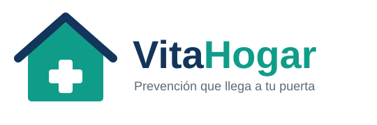

  

<h1 align="center">VitaHogar</h1>

<b>Servicio médico en casa · Plan preventivo</b>

  Proyecto académico de <b>Programación 1</b> · Segundo corte · Caso B 
  Desarrollado en <b>Java</b>

---

## 1. Sobre la empresa

> Identidad generada con apoyo de inteligencia artificial (Claude), como pide el caso de estudio.

### Nombre

**VitaHogar**

Combina *vita* (vida, en latín) y *hogar*. Expresa la idea central del servicio: llevar el cuidado de la salud a la casa de las personas.

**Eslogan:** *Prevención que llega a tu puerta.*

### Logo

La casa representa el hogar y el techo en azul marino transmite protección. La cruz médica blanca en el centro indica que la atención de salud está dentro de la casa. Los colores son verde azulado (salud y bienestar) y azul marino (confianza y seriedad).

  

| Elemento | Color |
|---|---|
| Verde azulado (salud) | `#0F9D8A` |
| Azul marino (confianza) | `#12355B` |
| Gris (texto secundario) | `#5B6B7A` |

### Misión

Brindar atención médica preventiva en el hogar de forma accesible, cercana y segura, con planes claros y adaptados a cada familia, cuidando siempre la privacidad de la información de nuestros usuarios.

### Visión

Para 2031, ser el servicio de medicina preventiva domiciliaria de referencia en Colombia, reconocido por la confianza de las familias, la calidad humana de su equipo y el uso responsable de la tecnología.

### Valores

| Valor | Significado |
|---|---|
| **Cercanía** | Vamos hasta donde está el paciente y lo tratamos con calidez. |
| **Prevención** | Cuidar antes de que se enferme es mejor que curar después. |
| **Confianza** | Planes y precios claros, sin sorpresas. |
| **Privacidad** | Los datos de salud se protegen y se usan solo con autorización. |
| **Responsabilidad** | Cumplimos la ley y respondemos por la calidad de lo que ofrecemos. |

---

## 2. Descripción del proyecto

VitaHogar es una empresa de servicio médico en casa que requiere un algoritmo en **Java** donde el cliente o usuario pueda observar y seleccionar las diferentes opciones de un plan preventivo.

### Planes

| Sigla | Plan | Costo |
|---|---|---|
| **PB** | Plan Básico | $275.325 COP |
| **PP** | Plan Premium | $325.650 COP |

### Datos que solicita el sistema

Nombre, cédula, síntomas, dirección de residencia, cantidad de personas cubiertas y tipo de plan.

### Funcionamiento general

- El sistema es **continuo**: permite registrar varios usuarios seguidos.
- Si el médico escribe la palabra **`medicamento`**, la factura actual termina y el sistema queda listo para el siguiente cliente.

### Menú del sistema

1. Registrar cliente (nombre, cédula, síntomas, dirección de residencia)
2. Tipo de plan (usar las siglas PB o PP)
3. Otros usuarios (debe ser un número entero)
4. Valor mensual (proceso = tipo de plan × otros usuarios)
5. Respaldo TXT
6. Descuento (si el síntoma es gripa o alergia, se aplica un descuento del 12,5 % en ambos planes)
7. Visualizar información
8. Salir

### Entregables del caso
01. Autor y video

- **Autor:**   Ashkan David Cardenas Sterling
- **Curso:** Programación 1 · Segundo corte · Caso B
- **Docente:** David Escobar Valencia
- **Video explicativo:** [Pega aquí el enlace]
